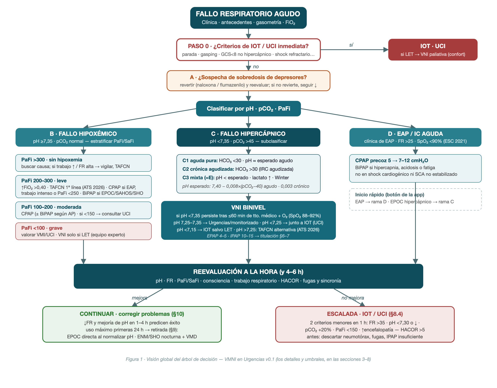

# Base de Conocimiento Clínico — VMNI en Urgencias

**Versión 0.1 — borrador para revisión científica**
Autor: Carlos J. Galán Doval · Coautor y revisor: Enrique Fernández Romero
Urgencias, Hospital de Montilla (Área de Gestión Sanitaria Sur de Córdoba)
Fecha: 27 de octubre de 2026

---

## 1. Marco de evidencia (jerarquía de fuentes)

Orden de prelación cuando las fuentes discrepan (criterio propuesto, pendiente de revisión):

1. **ATS 2026** — *Noninvasive Respiratory Support for Adult Patients with Acute Respiratory Failure*. Am J Respir Crit Care Med 2026;212:2135 (doi 10.1093/ajrccm/aamag302). Es la guía más reciente; actualiza la ERS/ATS 2017 e incorpora el alto flujo (TAFCN).
2. **ERS/ATS 2017** — Rochwerg B et al. Eur Respir J 2017;50:1602426. Sigue siendo la referencia para los escenarios que la ATS 2026 no reevaluó (EAP, inmunodeprimido, asma, postoperatorio, paliativo, trauma, destete).
3. **BTS/ICS 2016** — Davidson AC et al. Thorax 2016;71(Supl 2):ii1–ii35. La más operativa en fallo hipercápnico: parámetros, titulación y escalada.
4. **Consenso español 2021** (SEPAR, SEMICYUC, SEMES, SECIP, SENeo, SEDAR, SENP) — Luján M, Peñuelas Ó, Cinesi C et al. Med Intensiva 2021;45:298-312 (+ documento extenso). Marco organizativo y criterios de fracaso/IOT. SEMES es firmante: es el documento de referencia para Urgencias en España.
5. **GOLD 2026** (EPOC), **ESC 2021** (IC aguda/EAP), **Cochrane** por patología y estudios primarios.
6. **Manuales prácticos** (Artacho *Manual de Soporte Respiratorio*; Manual VMNI HUGCR; Carratalá *Foster Manual de ventilación mecánica* 2020; SEMES *Fundamentos*): detalle operativo donde las guías no llegan.

### 1.1 Resumen de recomendaciones por escenario

| Escenario | Recomendación | Fuerza / certeza | Fuente |
|---|---|---|---|
| EPOC agudizado con pH ≤7,35 y PaCO2 >45 | **VNI binivel** (fuerte ↓mortalidad y ↓intubación) | Fuerte / alta | ERS/ATS 2017 Q1b; BTS 2016 rec. 25 (A); ATS 2026 PICO2; consenso 2021 (verde, 100%) |
| EPOC hipercápnico **sin** acidosis | NO usar VNI | Condicional en contra / baja | ERS/ATS 2017 Q1a |
| EPOC: prueba de VNI antes de intubar (salvo deterioro inmediato) | Sí | Fuerte / moderada | ERS/ATS 2017 Q1b |
| Hipercapnia con acidemia **leve** (pH >7,25) | TAFCN como alternativa a VNI, con monitorización y escalada disponibles (~1/3 acaba en VNI) | Condicional / baja | ATS 2026 PICO2 |
| EAP cardiogénico (hospital) | **CPAP o binivel** (equivalentes) | Fuerte / moderada | ERS/ATS 2017 Q2a; consenso 2021 (verde, 100%); Cochrane 2019 |
| EAP prehospitalario | CPAP o binivel | Condicional / baja | ERS/ATS 2017 Q2b; Mal 2014 |
| IC aguda con FR >25 y SpO2 <90% | VNI precoz | Clase IIa, nivel B | ESC 2021 (IC) |
| Fallo hipoxémico de novo | **TAFCN** primera línea frente a O2 convencional; VNI/CPAP (mascarilla o helmet) sugeridas; sin preferencia TAFCN vs VNI | TAFCN: fuerte/moderada. VNI/CPAP: condicional/baja | ATS 2026 PICO1 (la ERS/ATS 2017 no hacía recomendación) |
| Neumonía sin comorbilidad cardiorrespiratoria | VNI no aconsejable (prueba solo con comorbilidad, en entorno monitorizado) | Rojo 73% / amarillo 93% | Consenso 2021 |
| SDRA moderado-grave | NO VNI (excepción: SDRA leve, PaFi 200-300) | Rojo 86% | Consenso 2021 |
| Inmunodeprimido con IRA | VNI temprana (beneficio cuestionado en ensayos posteriores; TAFCN alternativa) | Condicional / moderada | ERS/ATS 2017 Q4; matiz consenso 2021 |
| Asma aguda grave | Sin recomendación (ERS/ATS); prueba corta solo con vigilancia estrecha, idealmente UCI | Amarillo 93% | ERS/ATS 2017 Q3; consenso 2021; Cochrane 2012; Homer-Bouthiette 2025 (favorable, certeza baja) |
| SHO descompensado con acidosis | VNI (mismos criterios que EPOC; sin acidosis, si somnolencia + trastorno del sueño o IC derecha) | Verde 66% / BTS rec. 57 (B), 58 (D) | Consenso 2021; BTS 2016 |
| Neuromuscular / restrictivo agudo | VNI precoz **sin esperar acidosis** (VC <1 L + FR >20 ya la indica); no retrasar IOT si falla | BTS rec. 50-53 (D) | BTS 2016; consenso 2021 |
| Trauma torácico (sin neumotórax no drenado) | VNI con dolor controlado e hipoxemia no grave | Condicional / moderada | ERS/ATS 2017 Q8; consenso 2021 |
| Paliativo / disnea terminal | Ofrecer VNI como coadyuvante (no techo terapéutico); también con orden de no intubar en grupos de eficacia documentada | Condicional / moderada | ERS/ATS 2017 Q7; consenso 2021 |
| Post-extubación de alto riesgo | VNI profiláctica (≥65 años, comorbilidad cardiorrespiratoria, hipercapnia, VM prolongada, obesidad) | Condicional / moderada | ATS 2026 PICO4; ERS/ATS 2017 Q10a |
| Fallo post-extubación **ya establecido** | NO VNI (retrasa la reintubación) | Condicional en contra / baja | ERS/ATS 2017 Q10b; consenso 2021 |

### 1.2 Magnitud del efecto (para el módulo docente)

- **EPOC (Cochrane Osadnik 2017, 17 ECA, n=1264):** mortalidad RR 0,54 (0,38–0,76), NNT 12; intubación RR 0,36 (0,28–0,46), NNT 5; estancia −3,4 días. Beneficio igual con pH 7,30–7,35 que <7,30, y en planta que en UCI.
- **EAP (Cochrane Berbenetz 2019, 24 estudios, n=2664):** mortalidad RR 0,65 (0,51–0,82), NNT 17; intubación RR 0,49 (0,38–0,62), NNT 13; sin aumento de IAM (RR 1,03).
- **Asma (Cochrane Lim 2012; Homer-Bouthiette & Wilson, Ann Am Thorac Soc 2025):** evidencia escasa; en la revisión de 2025 todos los resultados significativos favorecieron a la VNI (intubación RR 0,46 en ECA, no significativa; observacionales RR 0,55), certeza baja-muy baja.
- **Prehospitalaria (Mal 2014, 7 ECA, n=632):** mortalidad RR 0,58, NNT 18; VMI RR 0,37, NNT 8 (certeza alta).
- **Fracaso real en urgencias españolas:** 4,5–9,8% de IOT en series de EAP/EPOC (Cano Ballesteros 2019; Carratalá 2010; serie SEMES n=207: BiPAP ineficaz 8,7%, IOT 4,3%).

---

## 2. Entradas de la app (evaluación inicial)

### 2.1 Antecedentes personales
Según el borrador inicial, con dos matices añadidos (en cursiva):

- **Patología respiratoria** (selección múltiple): EPOC · Sospecha de EPOC no confirmada · Asma · SAHOS · SHO · Trastorno restrictivo toracógeno · Patología respiratoria neuromuscular · Otros trastornos respiratorios · *Bronquiectasias/FQ (la BTS les da los mismos criterios que la EPOC, rec. 42)*.
- **Otros antecedentes:** Insuficiencia cardiaca · HTA · Diabetes · Enfermedad renal crónica · Enfermedad grave de otra etiología · *Inmunodepresión (cambia la recomendación: VNI/TAFCN temprana, ERS/ATS Q4)*.
- **Otras circunstancias:** O2 domiciliario (continuo / por horas) · *VMNI o CPAP domiciliaria previa (condiciona parámetros y retirada)* · Vida limitada / LET (activa la rama paliativa).

### 2.2 Situación clínica (signos de gravedad)
FR (valor numérico) · respiración abdominal paradójica · uso de musculatura accesoria · aumento evidente del trabajo respiratorio · nivel de consciencia (**GCS numérico**: lo exigen HACOR y los umbrales de contraindicación GCS ≤8) · FC · TA · SpO2.

Umbrales relevantes: FR >24 (criterio de inicio en EPOC, ERS/ATS p.6), FR >30 (fallo de novo), FR >35 persistente (fracaso probable, BTS ii16).

### 2.3 Gasometría: ¿arterial o venosa?

- **pH venoso:** fiable para cribado; sesgo medio ≈ −0,03 respecto al arterial (el venoso es más bajo). El 96% de pH arterial ≥7,35 también son venosos ≥7,35 (Kelly). **Regla de la app:** pH venoso + 0,03 ≈ pH arterial, con aviso de imprecisión.
- **pCO2 venosa:** NO intercambiable (sesgo ≈ +5–6 mmHg, límites de acuerdo amplios; Razi 2007). **Regla de cribado:** pCO2 venosa <45 mmHg descarta hipercapnia significativa; si ≥45 o hay acidosis, confirmar con arterial.
- **Consenso 2021 (p.91):** gasometría venosa aceptable en EAP sin shock ni patología obstructiva crónica; arterial en el resto.
- La PaO2 **solo** vale de gasometría arterial; con venosa, la oxigenación se evalúa por SpO2 → SaFi.

### 2.4 FiO2 administrada (estimación)

| Dispositivo | FiO2 estimada | Nota |
|---|---|---|
| Aire ambiente | 0,21 | — |
| Gafas nasales | 0,21 + **0,04** × L/min (clásica regla del 4%/L, hasta 6 L/min) | ⚠️ El borrador inicial decía «0,21 + 0,3×L/min»: errata evidente. Decidir 3%/L vs 4%/L (pendiente de revisión) |
| Ventimask (VK) | % del dispositivo / 100 | Directa |
| Reservorio | 4-5 L/min → 0,60 · 6-7 → 0,70 · 8-9 → 0,80 · ≥10 → 0,90 | Según borrador inicial (coherente con la docencia habitual) |
| TAFCN (AirVo) | FiO2 programada | Directa |
| Respirador **con** mezclador (V60, Vivo con módulo O2) | FiO2 programada | Directa |
| Respirador **sin** mezclador (O2 a caudalímetro) | Tabla Thys & Liistro (abajo). **No existen fórmulas propias del Vivo**: el fabricante no las publica (su manual solo limita el O2 a 15 L/min y recomienda monitorizar) | La FiO2 real depende de IPAP, flujo de O2, punto de conexión, fuga y patrón ventilatorio → la estimación es orientativa; titular por SpO2 y, si el equipo monta célula de FiO2, usar el valor medido |

**FiO2 (%) según flujo de O2 e IPAP** (Thys & Liistro, en Rev Am Med Resp 2021, tabla 2.3.5):

| O2 L/min | IPAP 8 | IPAP 12 | IPAP 16 | IPAP 20 |
|---|---|---|---|---|
| 2 | 24 | 24 | 24 | 22 |
| 4 | 28 | 29 | 26 | 23 |
| 6 | 32 | 33 | 30 | 26 |
| 8 | 36 | 36 | 32 | 30 |
| 10 | 40 | 38 | 35 | 35 |
| 12 | 44 | 41 | 38 | 37 |
| 15 | ~50 | ~46 | ~43 | ~42 |

> A mayor IPAP, menor FiO2 para el mismo flujo (más dilución). Conectar el O2 lo más cerca de la mascarilla (lado del puerto espiratorio) aumenta la FiO2.

### 2.5 Cálculos derivados

| Cálculo | Fórmula | Umbrales |
|---|---|---|
| **PaFi** | PaO2 / FiO2 | >300 normal · 200–300 leve · 100–200 moderada · <100 grave (clasificación del borrador, coherente con Berlín) |
| **SaFi** | SpO2 / FiO2 (válida solo con **SpO2 ≤97%**) | SaFi 315 ≈ PaFi 300 · SaFi 235 ≈ PaFi 200 (Rice 2007) · intermedios por interpolación (pendiente de revisión) |
| **pH esperado (hipercapnia aguda)** | pH = 7,40 − 0,008 × (PaCO2 − 40) | Si el pH real ≈ esperado → acidosis respiratoria **aguda** pura |
| **pH esperado (hipercapnia crónica)** | pH = 7,40 − 0,003 × (PaCO2 − 40) | Si el pH real ≈ este → crónica compensada; entre ambas → **crónica agudizada** |
| **HCO3 esperado** | Agudo: +1 mEq/L por cada 10 mmHg de ↑PaCO2 · Crónico: +3,5–4 mEq/L por 10 mmHg | HCO3 >30 con hipercapnia → componente crónico (IRC agudizada) |
| **Componente metabólico (Winter)** | PaCO2 esperada = 1,5 × HCO3 + 8 (±2) | PaCO2 real > esperada → acidosis mixta |
| **Lactato** | <2 mmol/L (≈18 mg/dL) normal | Borrador: <20 / 20–30 / >30 mg/dL. Láctico alto + pH menor del esperado → componente metabólico/hipoperfusión (pendiente de revisión) |
| **HACOR** (a 1–2 h de VNI) | FC + pH + GCS + PaFi + FR (0–25 puntos) | ≤5: fracaso ~18% · >5: fracaso ~78% (Duan 2017; validación externa más débil, AUC 0,71–0,83) (pendiente de revisión) |
| **Peso ideal** (para Vt objetivo) | Varón: 50 + 0,91×(talla cm −152,4) · Mujer: 45,5 + 0,91×(talla cm −152,4) | Vt objetivo 6–8 ml/kg ideal (ver §7) |

### 2.6 Clasificación ácido-base automática (añadida 27-10-2026)

La app aplica en vivo, sobre pH + pCO2 + HCO3, la lectura sistemática del enfoque fisiológico
(Berend, NEJM 2014 [26]) usando las fórmulas de §2.5:

1. **pH**: <7,35 acidemia · >7,45 alcalemia · en rango ≠ gasometría normal.
2. **Componente**: pCO2 >45 respiratorio · HCO3 <22 (o >26) metabólico · ambos en la misma dirección → **mixto**.
3. **Compensación**: acidosis respiratoria → pH esperado agudo/crónico (0,008/0,003 por mmHg; entre ambos = *crónica agudizada*); acidosis metabólica → Winter ±2 (pCO2 real mayor = compensación insuficiente; menor = alcalosis respiratoria añadida).
4. **pH normal con pCO2/HCO3 alterados** → trastorno compensado o mixto equilibrado (aviso explícito: el retenedor crónico compensado no es indicación urgente de VNI por sí solo).

En gasometría venosa se clasifica con el pH corregido (+0,03, §2.3) y se indica.
Tolerancia de ±0,02 sobre los pH esperados para el corte agudo/crónico.

### 2.7 Volúmenes y capacidades teóricos del espirograma docente (añadido 27-10-2026)

Solo para el módulo docente (no intervienen en el motor de recomendación):

| Valor | Fórmula | Fuente |
|---|---|---|
| **PBW** | la misma de §2.5 (ARDSNet) | ARDSNet [10] |
| **VT teórico** | PBW × 7 ml/kg (punto medio del rango fisiológico 6–8) | ARDSNet [10] |
| **CV teórica** | Varón: 0,052×talla −0,022×edad −3,60 · Mujer: 0,041×talla −0,018×edad −2,69 (L) | Knudson 1976 [27] |
| **VR teórico** | Varón: 1,31×talla(m) +0,022×edad −1,23 · Mujer: 1,81×talla(m) +0,016×edad −2,00 (L) | ECSC/ERS, Quanjer 1993 [28] |
| **Reparto** | VRE = 25% de la CV (proporción del adulto tipo); VRI = CV − VT − VRE; CRF = VR+VRE; CPT = CV+VR | Fisiología clásica (West) |

Validez: edad 16–100 años, talla 130–220 cm; fuera de rango la app no muestra valores.

> **Nota HCO3 (pregunta del borrador):** se necesita el **valor absoluto**, no categorías — las fórmulas de pH esperado y Winter lo requieren. La app puede mostrar además la categoría (<22 / 22–26 / 27–30 / >30).

---

## 3. Árbol de decisión (formalización del algoritmo A–E del borrador)

*Figura 1. Visión global del proceso: cribado de intubación (paso 0), rama de tóxicos (A), clasificación en fallo hipoxémico (B), hipercápnico (C) y EAP (D), reevaluación a la hora y salidas (continuar/retirada vs escalada). Los umbrales detallados, en el texto.*

### Paso 0 — Cribado de intubación/UCI inmediata (antes de cualquier VNI)
**IOT emergente** (consenso 2021, tabla 3; BTS Box 1): parada respiratoria o cardiaca · pausas respiratorias o gasping con pérdida de alerta · FC <50 con bajo nivel de consciencia · agitación incontrolable · aspiración masiva / secreciones no manejables · inestabilidad hemodinámica sin respuesta a volumen y vasoactivos · GCS <8 de causa no hipercápnica.
→ Si LET/paliativo: rama paliativa (VNI para confort si pertenece a grupos con eficacia documentada).

### Rama A — Sospecha de sobredosis de depresores
pH <7,30 + pCO2 >50 + clínica compatible, sin otros antecedentes → **revertir** (naloxona/flumazenilo según tóxico) + soporte; reevaluar gasometría. Si no revierte → continuar por B/C según patrón. *(Criterio del borrador; sin guía específica — validación de Enrique.)*

### Rama B — pH ≥7,35 con pCO2 normal/baja: **fallo hipoxémico**
Estratificar por PaFi (o SaFi):

| PaFi | Gravedad | Conducta propuesta |
|---|---|---|
| >300 | Sin hipoxemia | Si trabajo respiratorio intenso / FR alta: buscar causa; vigilar riesgo de agotamiento; considerar TAFCN |
| 200–300 | Leve | 1º subir FiO2 >0,40 y reevaluar. **TAFCN de primera línea** (ATS 2026). CPAP si EAP, trabajo intenso o PaFi <250; binivel si antecedente de EPOC/SAHOS/SHO/restrictivo |
| 100–200 | Moderada | CPAP (valorar binivel según antecedentes) o TAFCN con vigilancia estrecha. **PaFi <150 → avisar/consultar UCI** |
| <100 | Grave | **Valorar VMI/UCI.** VNI solo si LET, por equipo experto y reevaluación precoz |

Matices de guía: en neumonía sin comorbilidad la VNI no es aconsejable (consenso 2021); en SDRA moderado-grave, no VNI; el fracaso de VNI en de novo se asocia a Vt espontáneo alto y a retrasar la IOT (ERS/ATS p.9).

### Rama C — pH <7,35 con pCO2 >45: **fallo hipercápnico**
Subclasificar con HCO3, lactato y pH esperado:

| Patrón | Criterios | Lectura |
|---|---|---|
| C1. Acidosis respiratoria **aguda** pura | HCO3 <30, lactato normal, pH real ≈ esperado agudo | IRA hipercápnica de novo (EPOC agudizado, depresores…) |
| C2. Crónica **agudizada** | HCO3 >30, lactato normal, pH entre esperado agudo y crónico | IRC agudizada (EPOC evolucionado, SHO) |
| C3. Acidosis **mixta** | pH menor que el esperado respiratorio, y/o lactato alto, y/o Winter con PaCO2 > esperada | Buscar hipoperfusión/sepsis; peor pronóstico; VNI con más vigilancia |

Conducta común: **VNI binivel** si pH <7,35 persiste tras tratamiento médico óptimo con O2 controlado (SpO2 88–92%) durante máx. 60 min (BTS fig.1: pH <7,35 + PaCO2 >6,5 kPa [~49 mmHg] + FR >23). No esperar a la radiografía si pH <7,25 (BTS ii16).
Gravedad: pH 7,25–7,35 → VNI en Urgencias/área monitorizada · pH <7,25 → VNI con vía de IOT inmediata disponible (UCI/críticos) · pH <7,15 (o <7,25 con rasgo adverso) → IOT salvo LET (BTS ii18).
Acidemia leve (pH >7,25): TAFCN es alternativa con monitorización (ATS 2026) — relevante si hay AirVo disponible.

### Rama D — EAP/IC aguda (inicio rápido)
Criterios ESC 2021: FR >25, SpO2 <90% → **CPAP precoz** (5→7,5→10 cmH2O; ver §6). Binivel si hipercapnia, acidosis o fatiga. No en shock cardiogénico ni SCA no estabilizado (exclusiones ERS/ATS Q2a).

### Rama E — pH esperado mayor que el real (categoría del borrador)
Equivale a detectar componente metabólico añadido (C3): la app mostrará la descomposición (respiratorio vs metabólico) y recomendará buscar causa (lactato, cetoacidosis, renal) además del soporte ventilatorio.

### Inicio rápido (botón del borrador)
- **EAP** → rama D directa. Entradas mínimas: pH, pO2/SpO2, pCO2, FiO2.
- **EPOC hipercápnico** → rama C directa. Mismas entradas mínimas (para evaluar respuesta se repiten a 1 h).

---

## 4. Contraindicaciones de la VNI (fusión BTS 2016 · consenso 2021 · Neumosur)

**Absolutas:** necesidad de IOT emergente (paso 0) · imposibilidad de ajustar interfaz (trauma/quemadura/deformidad facial grave) · obstrucción fija de vía aérea superior · neumotórax no drenado (alta sospecha) · hemoptisis/hematemesis amenazante · coma no hipercápnico · rechazo del paciente · falta de control de secreciones · shock no estabilizable.

**Relativas** (aumentan el riesgo de fracaso; exigen entorno monitorizado): pH <7,15 (o <7,25 con rasgo adverso añadido) · GCS ≤8 de causa hipercápnica (la encefalopatía hipercápnica NO contraindica: puede revertir) · agitación/confusión · vómitos no controlados (sonda nasogástrica si distensión) · cirugía reciente de vía aérea o digestiva alta · secreciones abundantes · embarazo · inestabilidad hemodinámica moderada · FMO.

---

## 5. Modos ventilatorios en VMNI

> Añadido el 27-10-2026. La recomendación de modo por escenario (§5.3) y las reglas de cambio
> según evolución (§5.4) alimentan el motor de la app → decisiones abiertas **pendiente de revisión, pendiente de revisión y pendiente de revisión** (§14).

### 5.1 Los pilares (los modos del día a día)

| Modo | Qué hace | Indicación típica | En el parque del área |
|---|---|---|---|
| **CPAP** | Una sola presión continua. No ventila: recluta alveolos, oxigena y descarga el ventrículo izquierdo | EAP (equivalente a binivel en mortalidad e intubación); hipoxemia con shunt reclutable | V60 · Vivo 50/60 · VITAE 40 · Boussignac |
| **S (espontáneo)** | Binivel puro: el paciente dispara y cicla todos los ciclos (presión de soporte sobre EPAP) | Paciente con estímulo respiratorio fiable; en agudos casi siempre se prefiere S/T (respaldo) | V60 (S) · Vivo 50/60 (PSV sin respaldo) |
| **S/T (espontáneo-programado)** | Como S, pero con FR de respaldo: si el paciente no dispara en el tiempo programado, la máquina entrega un ciclo controlado por tiempo | **El caballo de batalla del fallo hipercápnico** (EPOC, SHO, restrictivo) — consenso 2021 p.81-82; BTS 2016 | V60 (S/T) · Vivo 50/60 (PSV con FR de respaldo) · VITAE 40 (binivel) |
| **T (programado)** | Todos los ciclos los inicia y cicla la máquina (FR y Ti fijos); ignora el esfuerzo del paciente | Sin estímulo respiratorio (sedación, encefalopatía profunda) cuando se decide mantener VNI; puente mientras se prepara otra cosa | V60 (PCV con FR fija) · Vivo 50/60 (PCV) |
| **PCV (controlada por presión)** | Presión inspiratoria con **Ti fijo** programado; asiste los esfuerzos y asegura ciclos si no los hay | ENM con disparo débil (BTS rec. 52); asincronía de ciclado refractaria (el Ti fijo elimina el ciclado por flujo, que la fuga pervierte); restrictivo que necesita Ti largo | V60 (PCV) · Vivo 50/60 (PCV) |

### 5.2 Modos avanzados: qué aportan y qué no

- **AVAPS / iVAPS (presión de soporte con objetivo de volumen).** La IPAP «flota» automáticamente entre un mínimo y un máximo para alcanzar un **Vt medio objetivo** (AVAPS, Philips) o una **ventilación alveolar objetivo** con FR inteligente (iVAPS, ResMed). Matiz clave: el ajuste es **GRADUAL (~1 cmH2O/min en AVAPS), no respiración a respiración** — por eso **no es un modo de rescate agudo**: ante un deterioro brusco responde tarde. Su sitio es la hipoventilación sostenida (SHO, restrictivo) y el soporte prolongado/nocturno. Evidencia: en superobesos con fallo hipercápnico, AVAPS **no mostró ventaja sobre una PS bien titulada** (Murphy, Thorax 2012 [29]). Parque: AVAPS en el V60; «volumen asegurado» en Vivo 50/60; iVAPS no disponible (equipos ResMed).
- **PAV y NAVA (modos proporcionales al esfuerzo).** Asisten en proporción al esfuerzo instantáneo del paciente (PAV por mecánica estimada; NAVA por la actividad eléctrica diafragmática, catéter Edi). **Mejoran la sincronía** — NAVA reduce el índice de asincronías frente a PS en estudios fisiológicos de VMNI (Piquilloud 2012 [31]) — pero **sin beneficio demostrado en resultados duros** (mortalidad, intubación). PAV+ es hoy casi exclusivo de la ventilación invasiva (la PAV no invasiva se probó en agudos: Gay 2001 [32]); NAVA exige catéter Edi y ventilador Servo (Getinge): **ninguno disponible en el área**. Valor en la app: docente.
- **PRVC (presión regulada con volumen garantizado).** Controlada por presión que retitula la presión respiración a respiración para garantizar el Vt. Adaptación de la invasiva; **uso residual en VMNI aguda** (la fuga hace poco fiable el Vt medido).
- **ASV (ventilación servoadaptativa).** Presión de soporte anticíclica (asiste más cuando el paciente ventila menos) diseñada para la respiración periódica / apnea central. ⚠️ **Aviso de seguridad obligatorio en la app:** **contraindicada en la insuficiencia cardiaca con FEVI ≤45% y apnea central predominante** — el ensayo SERVE-HF (Cowie, NEJM 2015 [30]) mostró **exceso de mortalidad cardiovascular** (HR 1,34) en ese grupo. No disponible en Urgencias del área, pero algunos pacientes la llevan domiciliaria (unidades de sueño): ante un EAP/IC descompensada, comprobarlo.

### 5.3 Modo recomendado por escenario clínico ( (pendiente de revisión))

| Escenario | Modo recomendado | Alternativas / matices | Referencia |
|---|---|---|---|
| EAP / IC aguda | **CPAP** | Binivel S/T equivalente (preferirlo si hipercapnia, acidosis o fatiga) | ERS/ATS 2017 Q2a; ESC 2021; Masip 2018; Cochrane 2019 |
| EPOC hipercápnico (pH <7,35) | **Binivel S/T** | TAFCN si acidemia leve (pH >7,25) con monitorización (ATS 2026); PCV con Ti fijo si asincronía refractaria | BTS 2016; ERS/ATS 2017 Q1b; consenso 2021; GOLD |
| SHO / restrictivo toracógeno | **Binivel S/T** | PCV con Ti largo (1,2–1,5 s); **± volumen asegurado** si Vt insuficiente pese a IPAP alta o para soporte prolongado/nocturno (no como rescate: ajuste gradual) | BTS 2016 rec. 57; consenso 2021; Murphy 2012 [29] |
| Neuromuscular | **S/T o PCV con Ti largo** (PCV si disparo débil) | Volumen asegurado para soporte prolongado; no retrasar IOT si falla | BTS 2016 rec. 50–53 |
| Sin estímulo respiratorio / sedación (VNI mantenida) | **T** (o PCV con FR fija) | Solo en entorno monitorizado con vía aérea vigilada; reevaluar indicación de IOT | BTS 2016; consenso 2021 (criterio operativo) |
| Hipoxémico de novo | **TAFCN** (1.ª línea) | CPAP (mascarilla o helmet) o binivel según antecedentes | ATS 2026 PICO1 |

### 5.4 Cambio de modo según evolución ( (pendiente de revisión))

1. **Asincronía persistente** pese a optimizar fugas, trigger, rampa y % de ciclado (§10) → valorar **PCV con Ti fijo** (el ciclado por tiempo es inmune a la fuga).
2. **Vt insuficiente / hipoventilación persistente** pese a IPAP alta, o **hipoventilación nocturna** con necesidad de soporte prolongado (SHO, restrictivo, ENM) → valorar **volumen asegurado** (AVAPS en V60; volumen asegurado en Vivo 50/60).
3. **Pérdida del estímulo respiratorio** (sedación, encefalopatía) manteniendo la VNI → **modo T**, y reevaluar la indicación de IOT.
4. El cambio de modo **nunca sustituye a la escalada**: si se cumplen criterios de fracaso (§8.3), la salida es IOT/UCI, no otro modo.

---

## 6. Parámetros iniciales por escenario

> Valores de inicio "seguros" + rango de titulación. Donde las fuentes discrepan se indica el rango y la opción propuesta, pendiente de revisión.

### 6.1 Binivel (EPOC agudizado — escenario de referencia)

| Parámetro | Inicio | Titulación | Fuente |
|---|---|---|---|
| EPAP | 4–5 cmH2O (mínimo 4 con rama única, evita reinhalación) | Subidas de 1–2 hasta compensar autoPEEP / esfuerzos inefectivos. Techo habitual 8 sin revisión experta | BTS (inicio 3); Artacho; consenso (5-6); pendiente de revisión |
| IPAP | 10–12 cmH2O (BTS: 15 directo; 20 si pH <7,25) | +2–3 cmH2O cada 10–30 min según tolerancia, Vt y FR. Techo habitual 20–25; no superar 30 | BTS ii9; Foster p.39-40; pendiente de revisión |
| FR respaldo | 12–15 rpm | — | Foster/Artacho (BTS dice 16–20; pendiente de revisión) |
| Ti / I:E | Ti 0,8–1,2 s · I:E 1:2–1:3 | Apnea tolerada 8–15 s | BTS; Artacho |
| Rampa (rise) | Rápida-media, la más corta tolerada | Más lenta si intolerancia | Artacho; Foster |
| Trigger insp. | Flujo 3–5 L/min (sensible, sin autociclado) | — | Artacho D4 |
| Ciclado esp. | ~25%; subir a 40–60% si Ti largo o esfuerzos inefectivos (obstructivos >25%) | — | Artacho |
| O2 / SpO2 | Objetivo **88–92%**. FiO2 inicio 0,3–0,4 si regulable; si caudalímetro, ajustar por SpO2 | Subir FiO2 solo tras optimizar ventilación; >4 L/min por caudalímetro genera fugas/asincronía → preferir equipo con mezclador | BTS rec. 4 (A) |

### 6.2 Binivel en restrictivo / SHO / neuromuscular

- **SHO:** EPAP 8–10 (hasta 10–15 si IMC >35 / SAHOS), IPAP alta (puede superar 25–30 para lograr Vt). Ti 1,2–1,5 s; I:E 1:1–1:2; ciclado <25%.
- **ENM:** IPAP 10 de inicio (o +5 sobre su ventilador habitual), suele bastar PS 8–12; considerar PCV si disparo débil. No retrasar IOT si falla (BTS rec. 53).
- **Cifoescoliosis:** IPAP >20, a veces >30 (Artacho p.102); EPAP puede subir para reclutar.

### 6.3 CPAP (EAP)

| Parámetro | Valor |
|---|---|
| Inicio | 4–5 cmH2O |
| Titulación | +2 cmH2O cada 5–10 min hasta la mínima presión eficaz (SpO2 ≥92–93%, ↓FR, ↓trabajo) |
| Rango habitual | 7–12 cmH2O (Boussignac igual; >15–18 sin objetivos → cambiar modo o IOT) |
| FiO2 | Alta al inicio (1,0 con sistema convencional), bajar 15–20% cada 30 min hasta ≤0,5 con SpO2 ~93% |
| Retirada | Bajar 2 cmH2O cada 30 min hasta 4–5; sustituir por TAFCN 35–40 L/min u O2 convencional |

### 6.4 TAFCN (AirVo)

Flujo 45–50 L/min (inicio a 30–40 si intolerancia) · Temperatura 37 °C · FiO2 mínima para SpO2 93–94% (88–92% si riesgo hipercápnico) · **Índice ROX** (SaFi/FR) ≥4,88 a las 12 h se asocia a éxito (consenso 2021 p.87-88).

### 6.5 Objetivos de SpO2 (unificación propuesta (pendiente de revisión))

- Riesgo hipercápnico (EPOC, SHO, ENM, toracógeno): **88–92%** (BTS rec. 4, grado A).
- Resto (EAP, hipoxémico de novo): **92–96%**.

---

## 7. Titulación y objetivos

1. Posición 30–45°, monitorización (SpO2 continua, FR, FC, TA, GCS), explicar la técnica, sujetar la mascarilla con la mano al inicio, arnés sin tensión excesiva (pasar 2 dedos).
2. **Vt objetivo: 6–8 ml/kg de peso ideal** (BTS/criterio mayoritario; rango 5–7 según Foster; riesgo si >9,5) y FR <25 rpm.
3. Hipoxemia persistente → subir EPAP de 2 en 2 (máx. 8–12 según escenario) → después FiO2.
4. Hipercapnia persistente → mejorar sincronía y fugas → subir IPAP (techo 20–25) → reducir espacio muerto (mascarilla menor, puerto espiratorio próximo, válvula antirreinhalación si acidosis grave).
5. Uso continuo las primeras horas (máximo uso en las primeras 24 h, BTS ii17), pausas breves para comida/nebulización (nebulizar sin interrumpir la VNI si es dependiente: malla vibrante en T o pMDI con cámara en rama inspiratoria).
6. Sedación cautelosa solo en entorno monitorizado (morfina 2,5–5 mg IV en agitación/taquipnea — BTS buena práctica; dexmedetomidina/remifentanilo en UCI).

---

## 8. Monitorización, respuesta y fracaso

### 8.1 Tiempos
- **Gasometría:** basal → **a 1 h** (consenso p.91; BTS: 1–2 h) → a las 4–6 h → tras cada cambio relevante y a las 8–12 y 24 h.
- Vigilancia clínica cada 10–15 min la primera hora; 30–45 min hasta la 4ª h; horaria hasta la 12ª (Foster p.33).

### 8.2 Respuesta favorable (1–4 h)
↓FR y mejoría del pH (mejores predictores de éxito, BTS nivel 1+) · ↓trabajo respiratorio y FC · mejoría del nivel de consciencia · Vt adecuado con fugas controladas.

### 8.3 Criterios de fracaso (consenso 2021, pp. 95–100)
1. Deterioro clínico o incapacidad de mejorar: disnea persistente con tiraje, **FR que no baja de 30 a la 1ª hora** (no retrasar IOT), deterioro de consciencia.
2. Intolerancia con deseo de retirada; asincronías no corregibles.
3. Gasométrico a 1 h: hipercápnico — PaCO2 persistentemente elevada o pH que no mejora (pH <7,25 pese a VNI óptima = bandera roja BTS) · hipoxémico — **PaFi ≤146** (≤175 en SDRA).
4. Broncorrea no expectorable · inestabilidad hemodinámica, isquemia o arritmias letales.
5. **HACOR >5** a 1–2 h (apoyo, no sustituto del juicio clínico).

Tipos: inmediato (<1 h), precoz (1–48 h, el más frecuente), tardío (>48 h: infección, delirio).

### 8.4 Criterios de IOT (consenso p.100; BTS Box 1)
**Mayores (IOT inmediata):** los del paso 0. **Menores (2 en la primera hora):** FR >35 o mayor que la inicial · pH <7,30 o menor que el inicial, o PaCO2 +20% sobre la inicial · PaFi <150 · empeoramiento de la encefalopatía.
Antes de intubar, descartar y corregir: neumotórax, broncoaspiración, IC, fugas/interfaz inadecuada, IPAP insuficiente (subir hasta ~20 y revisar válvula espiratoria).

### 8.5 Derivación a UCI (BTS fig.1 + consenso tabla 6)
pH <7,25 mantenido · PaFi <150 · amenaza de parada · imposibilidad de mantener SpO2 >85–88% · necesidad de sedación IV · neumonía grave, SDRA, trauma torácico · posible vía aérea difícil (SHO, distrofia).

---

## 9. Retirada de la VNI

- **EPOC:** retirada **directa** cuando se resuelve el episodio: pH normalizado (≥7,35) con PaCO2 mejorada (<50), estabilidad clínica y tolerancia a respiración espontánea (prueba de 4 h con O2 controlado). Prolongar VNI nocturna 3 noches NO reduce recaídas y alarga la estancia (Sellarés, ERJ 2017, ECA n=120; recaída 17% vs 13%, ns). Pauta alternativa si se prefiere gradual: BTS ii17 — retirada progresiva 2–3 días, suspendiendo primero el día.
- **Criterio de recaída** (Sellarés): ≥2 de — pH <7,35 con PaCO2 >45 · SpO2 <90% o PaO2 <60 con FiO2 ≥0,5 · ≥30 min de FR >35, ↓consciencia, agitación o fatiga → reiniciar VNI.
- **ENM/toracógeno:** retirada lenta; mantener VNI nocturna; objetivo PaCO2 45–50 en espontánea; derivar a VMD.
- **SHO:** retirada diurna como EPOC + VNI/CPAP nocturna y estudio de sueño/VMD al alta.
- **CPAP en EAP:** ver §6.3.
- **Al alta tras fallo hipercápnico** (BTS Box 4): valorar derivación a VMD (hipercapnia persistente >53–56 mmHg a las 2–4 semanas se asocia a reingreso — consenso p.105), rehabilitación respiratoria, revisión precoz.

---

## 10. Resolución de problemas y asincronías (módulo "fallos" y simulador)

> La fuga excesiva es la causa más frecuente de asincronía: **corregir fugas antes de tocar parámetros** (Foster p.49).

| Asincronía | Firma en las curvas | Causas | Corrección |
|---|---|---|---|
| **Autociclado** (autotrigger) | Ciclo sin deflexión negativa previa en presión | Fugas, agua/artefactos en tubuladura, trigger demasiado sensible | Reducir fuga; bajar sensibilidad del trigger; revisar circuito |
| **Esfuerzo inefectivo** | Deflexión positiva en flujo sin ciclo (sin cambio de presión) | AutoPEEP, trigger poco sensible, PS excesiva, debilidad | Subir EPAP (sin superar la PEEPi; regla 80%); sensibilizar trigger; bajar IPAP si sobreasistencia; broncodilatar |
| **Retraso de trigger** | Desfase flujo→presión >100–200 ms | Hiperinsuflación, fugas | Como el anterior; alargar espiración |
| **Flujo insuficiente** (presurización lenta) | Presión cóncava, flujo redondeado; disnea | Rampa lenta, IPAP baja, demanda alta | Subir IPAP; rampa más rápida; reducir fugas |
| **Sobreasistencia / flujo excesivo** | Pico de presión/flujo brusco, intolerancia | IPAP/rampa excesivas | Bajar IPAP o alargar rampa |
| **Doble disparo** | Dos ciclos de presión sin espiración entre ellos | Ti mecánico < Ti neural, demanda alta | Alargar Ti; modo por presión; revisar PS |
| **Ciclado tardío** | Elevación final de presión >2 cmH2O sobre IPAP, caída brusca de flujo; espiración activa | Criterio de ciclado bajo, fugas, PS alta | Subir % de ciclado (>25–50% en obstructivos); reducir fugas; bajar PS |
| **Ciclado precoz** | Flujo espiratorio que "rebota" hacia la línea de base (el paciente sigue inspirando) | Criterio de ciclado alto | Bajar % de ciclado; Ti mínimo; modos por tiempo |
| **Fugas** | Trigger y ciclado erráticos, Vt sobrestimado, ruido | Interfaz/talla/arnés, boca abierta (nasal) | Reajustar o cambiar interfaz; parches hidrocoloides; bajar presiones a lo mínimo eficaz |
| **Reinhalación CO2** | PaCO2 que no baja pese a buena mecánica | Espacio muerto, EPAP <4, puerto lejano | EPAP ≥4–5; válvula antirreinhalación; mascarilla de menor espacio muerto |

**Complicaciones y frecuencia** (HUGCR p.22): fugas 80–100% · sequedad/congestión 25–70% · incomodidad 30–50% · distensión gástrica 30–50% (improbable con pico <25 cmH2O; SNG si vómitos) · irritación ocular 15–30% · úlcera nasal 5–20% (parches, rotar interfaz) · broncoaspiración ~5% · claustrofobia ~10%.

---

## 11. Interfaces

| Interfaz | Uso en agudo | Claves |
|---|---|---|
| **Oronasal** | **Primera elección en IRA** (BTS rec. 2) | Espacio muerto ~180–250 ml; proteger puente nasal (hidrocoloide) desde el inicio |
| Facial total | Alternativa: menos fugas y úlceras, mejor tolerancia prolongada | Más espacio muerto; rotar con la oronasal |
| Helmet | Hipoxémico/pandemias; edéntulos | EPAP ~10, PS hasta 20, tubuladura corta; presurización amortiguada |
| Nasal | No recomendada en IRA (fuga bucal) | Útil en destete/VMD |

Elección por anatomía, consciencia, claustrofobia y compatibilidad con el circuito (fuga intencional vs válvula). Con circuito de rama única y fuga intencional: EPAP mínima 4 cmH2O.

---

## 12. Dispositivos del área (pendiente de completar con los manuales de cada equipo (pendiente de revisión))

| Equipo | Tipo | Notas para la app |
|---|---|---|
| **Breas Vivo 50 / Vivo 60** | Ventilador de soporte vital domiciliario/hospitalario, turbina, rama única | Modos PSV/PCV/CPAP (± volumen asegurado). O2 por caudalímetro de serie → FiO2 estimada con la tabla de banco §2.4 (orientativa); O2 máx. 15 L/min según fabricante; si monta célula de FiO2, prevalece el valor medido |
| **Philips V60** | Ventilador de VNI hospitalario con mezclador | FiO2 directa; modos CPAP/S/T/PCV/AVAPS; compensación de fugas Auto-Trak. Aparece en los vídeos de Artacho (Práctica 2) |
| **Hersill VITAE 40** | Ventilador de transporte (sala de críticos) | Verificar modos de VNI/CPAP disponibles y manejo de FiO2 (aire comprimido/Venturi) con el manual del equipo |
| **AirVo (F&P)** | TAFCN | Flujo/FiO2/temperatura directos (§6.4) |

El simulador de la app mostrará las curvas en modo **genérico** y con "pieles" (skins) de estos equipos.

---

## 13. Tratamiento farmacológico por escenario — VALIDADO (27-10-2026)

> **Recomendaciones generales** según guías aceptadas (GesEPOC 2021, GOLD, ESC 2021, GINA/GEMA, BTS). **No sustituyen la valoración individual**: alergias, antecedentes, enfermedades concomitantes, interacciones, función renal/hepática, embarazo, y los protocolos y mapa de resistencias del centro. Dosis orientativas de adulto. **La app aconseja: la decisión de prescribir, ajustar o retirar es siempre del profesional.** Detalle completo en `docs/FARMACOS.md`.

### 13.1 Agudización de EPOC *(GOLD · GesEPOC)*
Salbutamol ± ipratropio nebulizado (2,5–5 mg + 0,5 mg cada 20–30 min la 1.ª hora, luego /4–6 h; **sin interrumpir la VNI**: malla en T) · **Prednisona 40 mg vo 5 días** (metilprednisolona IV si no vo; mayor eficacia con eosinófilos ≥300) · Antibiótico si purulencia (Anthonisen ≥2), PCR ≥20 **o necesidad de VNI** (que por sí sola lo indica): amoxicilina-clavulánico 875/125 /8 h 5–7 días, ajustado al mapa local · HBPM profiláctica. **Evitar:** metilxantinas de rutina, O₂ sin control.

### 13.2 EAP / IC aguda *(ESC 2021)*
**Furosemida IV 20–40 mg en bolo** (o 1–2× su dosis oral), repetir/perfusión según respuesta · NTG sl/IV (10–20 µg/min titulando) **solo si TAS >110** (evitar en TAS <100, estenosis aórtica grave, IAM de VD) · **Morfina NO rutinaria** (2,5–5 mg solo disnea/ansiedad refractarias: su uso rutinario se asocia a peor pronóstico) · tratar el desencadenante (SCA, arritmia, crisis HTA) · HBPM.

### 13.3 Crisis asmática grave *(GINA · GEMA)*
SpO₂ objetivo **93–95%** · salbutamol 4–10 puls./20 min la 1.ª hora (o neb 2,5–5 mg ×3) **+ ipratropio 0,5 mg en la grave** · **corticoide sistémico en la 1.ª hora** (prednisona 40–50 mg vo o hidrocortisona 100–200 mg IV) · **sulfato de magnesio 2 g IV en 20 min** solo en la grave sin respuesta. **Evitar:** sedantes fuera de la UCI.

### 13.4 Sobredosis de depresores *(rama A)*
**Primero ventilar.** Naloxona 0,04–0,1 mg IV cada 2–3 min **titulando hasta FR ≥10** (no hasta despertar); opioides largos → perfusión (~2/3 de la dosis eficaz/h); vigilancia prolongada · Flumazenilo de uso **excepcional** (0,2 mg IV lentos, máx. 1–2 mg): **contraindicado** en dependencia de BZD, coingesta proconvulsivante o epilepsia.

### 13.5 Coadyuvantes durante la VNI
Nebulización sin interrumpir la VNI · morfina 2,5–5 mg IV titulada en intolerancia (BTS, solo entorno monitorizado) · HBPM en el encamado · los cuidados de confort de la §10.

### 13.6 Ajustes locales pendientes
Antibiótico empírico según el mapa de resistencias del área (F-1) y cotejo fino de las clases ESC (F-2); el resto de decisiones F-3…F-7 quedaron resueltas con la validación del documento de fármacos.

## 14. Bibliografía

1. ATS. Noninvasive Respiratory Support for Adult Patients with Acute Respiratory Failure: An Official American Thoracic Society Clinical Practice Guideline. Am J Respir Crit Care Med 2026;212:2135. doi:10.1093/ajrccm/aamag302.
2. Rochwerg B et al. Official ERS/ATS clinical practice guidelines: noninvasive ventilation for acute respiratory failure. Eur Respir J 2017;50:1602426.
3. Davidson AC et al. BTS/ICS guideline for the ventilatory management of acute hypercapnic respiratory failure in adults. Thorax 2016;71(Supl 2):ii1–ii35.
4. Luján M, Peñuelas Ó, Cinesi C et al. Sumario de recomendaciones… VNI y TAFCN en IRA grave (SEPAR/SEMICYUC/SEMES/SECIP/SENeo/SEDAR/SENP). Med Intensiva 2021;45:298-312 (+ documento extenso).
5. GOLD. Global Strategy for the Diagnosis, Management, and Prevention of COPD. Report 2026. goldcopd.org. *(Umbral NIV: pH ≤7,35 y/o PaCO2 ≥45 mmHg + disnea con fatiga/↑trabajo — verificar texto 2026.)*
6. McDonagh TA et al. 2021 ESC Guidelines for the diagnosis and treatment of acute and chronic heart failure. Eur Heart J 2021;42:3599-3726.
7. Osadnik CR et al. Cochrane Database Syst Rev 2017;7:CD004104 (VNI en EPOC).
8. Berbenetz N et al. Cochrane Database Syst Rev 2019:CD005351 (CPAP/binivel en EAP).
9. Lim WJ et al. Cochrane Database Syst Rev 2012:CD004360 (VNI en asma).
10. Homer-Bouthiette C, Wilson KC. Noninvasive Ventilation in Acute Asthma Exacerbations: A Systematic Review. Ann Am Thorac Soc 2025;22:776-784.
11. Sellarés J et al. Discontinuing noninvasive ventilation in severe COPD exacerbations: a randomised controlled trial. Eur Respir J 2017;50:1601448.
12. Duan J et al. HACOR score (derivación y validaciones, 2017-2022). Intensive Care Med 2017;43:192-199; Ann Intensive Care 2019;9:108.
13. Mal S et al. Out-of-hospital NIPPV in severe respiratory distress: systematic review and meta-analysis. Ann Emerg Med 2014;63:600-607.
14. Rice TW et al. Comparison of the SpO2/FiO2 ratio and the PaO2/FiO2 ratio (ARDSNet). Chest 2007;132:410-417.
15. Kelly AM et al. Agreement between arterial and venous blood gases (pH/HCO3) en agudos; Razi E et al. (pCO2 venosa, 2007).
16. Masip J et al. Indications and practical approach to non-invasive ventilation in acute heart failure. Eur Heart J 2018;39:17-25.
17. Artacho R et al. Manual de Soporte Respiratorio (cap. VMNI en fallo respiratorio agudo) y material didáctico asociado (Inicio VMNI; VMNI en EPOC: corrección de problemas).
18. Carratalá JM (coord.). Foster: Manual de ventilación mecánica no invasiva y alto flujo. 2020.
19. Manual de VMNI del HUGCR; Fundamentos de VMNI (grupo VNI de SEMES); Neumosur (caps. 13-14, 3ª ed.).
20. Thys F, Liistro G et al. FiO2 estimada en ventiladores sin mezclador (tabla reproducida en Rev Am Med Resp 2021).
21. GesEPOC 2021 — síndrome de agudización de la EPOC. Arch Bronconeumol 2022;58:159-170.
22. GINA. Global Strategy for Asthma Management and Prevention (edición vigente). ginasthma.org.
23. GEMA — Guía Española para el Manejo del Asma (edición vigente). gemasma.org.
24. Cano Ballesteros JC. VNI en la IRA en urgencias: aplicabilidad y pronóstico. Tesis doctoral UCM, 2019.
25. Carrera Cueva C et al. Cap. 1309 Ventilación Mecánica No Invasiva (manual de urgencias, "RespVMNI").
26. Berend K, de Vries APJ, Gans ROB. Physiological approach to assessment of acid-base disturbances. N Engl J Med 2014;371:1434-1445.
27. Knudson RJ et al. The maximal expiratory flow-volume curve: normal standards, variability, and effects of age. Am Rev Respir Dis 1976;113:587-600.
28. Quanjer PH et al. Lung volumes and forced ventilatory flows. Official Statement of the European Respiratory Society. Eur Respir J 1993;6(Supl 16):5-40.
29. Murphy PB et al. Volume targeted versus pressure support non-invasive ventilation in patients with super obesity and chronic respiratory failure: a randomised controlled trial. Thorax 2012;67:727-734.
30. Cowie MR et al. Adaptive servo-ventilation for central sleep apnea in systolic heart failure (SERVE-HF). N Engl J Med 2015;373:1095-1105.
31. Piquilloud L et al. Neurally adjusted ventilatory assist improves patient–ventilator interaction during non-invasive ventilation delivered by face mask. Intensive Care Med 2012;38:1624-1631.
32. Gay PC, Hess DR, Hill NS. Noninvasive proportional assist ventilation for acute respiratory insufficiency: comparison with pressure support ventilation. Am J Respir Crit Care Med 2001;164:1606-1611.

---

## Anexo A. Glosario de siglas y acrónimos

| Sigla | Significado |
|---|---|
| AP | Antecedentes personales |
| APACHE II | Acute Physiology and Chronic Health Evaluation II (score de gravedad) |
| ASV | Ventilación servoadaptativa (adaptive servo-ventilation) |
| ATS | American Thoracic Society |
| AVAPS | Average Volume-Assured Pressure Support (presión de soporte con volumen medio asegurado) |
| BiPAP / binivel | Ventilación con doble nivel de presión (IPAP + EPAP) |
| BTS | British Thoracic Society |
| CPAP | Presión positiva continua en la vía aérea |
| DM | Diferencia de medias (metaanálisis) |
| EAP | Edema agudo de pulmón |
| ECA | Ensayo clínico aleatorizado |
| ECCO2R | Eliminación extracorpórea de CO2 |
| ENM | Enfermedad neuromuscular |
| EPAP | Presión positiva espiratoria en la vía aérea |
| EPOC | Enfermedad pulmonar obstructiva crónica |
| ERC | Enfermedad renal crónica |
| ERS | European Respiratory Society |
| ESC | European Society of Cardiology |
| FC | Frecuencia cardiaca |
| FiO2 | Fracción inspirada de oxígeno |
| FMO | Fallo multiorgánico |
| FQ | Fibrosis quística |
| FR | Frecuencia respiratoria |
| GA / GV | Gasometría arterial / venosa |
| GCS | Escala de coma de Glasgow |
| GN | Gafas nasales |
| GOLD | Global Initiative for Chronic Obstructive Lung Disease |
| GRADE | Sistema de gradación de la certeza de la evidencia |
| HACOR | Heart rate, Acidosis, Consciousness, Oxygenation, Respiratory rate (score de fracaso de VNI) |
| HCO3 | Bicarbonato |
| HME | Intercambiador de calor y humedad (humidificación pasiva) |
| HTA | Hipertensión arterial |
| HUGCR | Hospital Universitario Gran Canaria Dr. Negrín (manual de VMNI) |
| IAM | Infarto agudo de miocardio |
| IC / ICC | Insuficiencia cardiaca (congestiva) |
| IC95% | Intervalo de confianza al 95% |
| IMC | Índice de masa corporal |
| IOT | Intubación orotraqueal |
| IPAP | Presión positiva inspiratoria en la vía aérea |
| I:E | Relación inspiración:espiración |
| IRA / IRC | Insuficiencia respiratoria aguda / crónica |
| iVAPS | Intelligent Volume-Assured Pressure Support (ventilación alveolar objetivo, ResMed) |
| LET | Limitación del esfuerzo terapéutico |
| NAVA | Neurally Adjusted Ventilatory Assist (asistencia ajustada a la actividad eléctrica diafragmática, catéter Edi) |
| NNT / NNTB | Número necesario a tratar (para beneficiar) |
| OR | Odds ratio |
| PaCO2 / pCO2 | Presión parcial de CO2 (arterial) |
| PaFi | Cociente PaO2/FiO2 |
| PaO2 / pO2 | Presión parcial de O2 (arterial) |
| PAV | Ventilación asistida proporcional |
| PC / PCV | Ventilación controlada por presión |
| PEEP / autoPEEP (PEEPi) | Presión positiva al final de la espiración / PEEP intrínseca |
| PRVC | Presión regulada con volumen garantizado (pressure-regulated volume control) |
| PS | Presión de soporte (IPAP − EPAP) |
| PtcCO2 / TcPCO2 | CO2 transcutáneo |
| ROX | Índice (SpO2/FiO2)/FR para alto flujo |
| RR | Riesgo relativo |
| S / S/T / T | Modos espontáneo / espontáneo-programado / programado |
| SaFi | Cociente SpO2/FiO2 |
| SAHOS | Síndrome de apnea-hipopnea obstructiva del sueño |
| SBT | Prueba de respiración espontánea (spontaneous breathing trial) |
| SCA | Síndrome coronario agudo |
| SDRA | Síndrome de distrés respiratorio agudo |
| SEDAR / SECIP / SEMES / SEMICYUC / SENeo / SENP / SEPAR | Sociedades científicas españolas firmantes del consenso 2021 |
| SHO | Síndrome de hipoventilación-obesidad |
| SNG | Sonda nasogástrica |
| SpO2 / SaO2 | Saturación de O2 por pulsioximetría / arterial |
| TA / TAS | Tensión arterial (sistólica) |
| TAFCN | Terapia de alto flujo con cánulas nasales (HFNC) |
| Ti | Tiempo inspiratorio |
| UCI / HDU / UCRI | Unidad de cuidados intensivos / intermedios / respiratorios intermedios |
| VC / Vt | Volumen corriente (tidal) |
| VK | Ventimask (mascarilla Venturi) |
| VMD | Ventilación mecánica domiciliaria |
| VMI | Ventilación mecánica invasiva |
| VMNI / VNI | Ventilación mecánica no invasiva |
